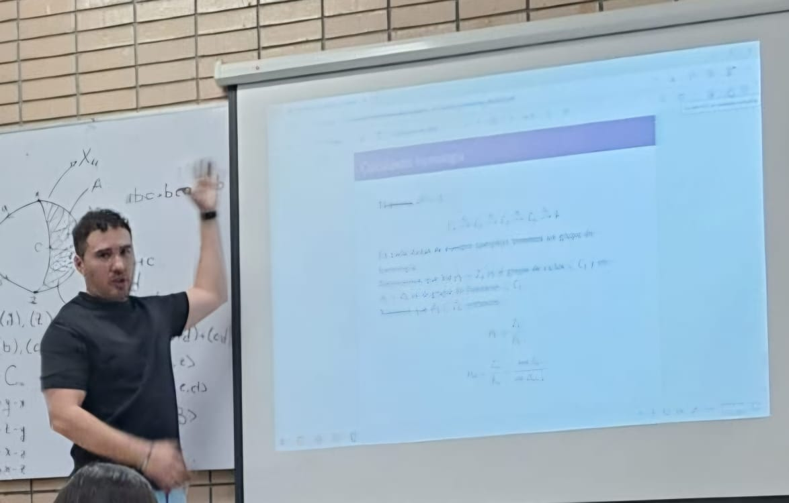

I have approximately **ten years of experience** teaching mathematics across undergraduate and high school levels. My teaching approach emphasizes conceptual clarity, structured problem-solving, and building intuition through concrete algebraic and geometric examples.

---

## University Teaching Experience

### Instructor — Universidad Autónoma de Nuevo León (UANL)
*Monterrey, Mexico | 2023 – 2024*  
Delivered lectures, designed problem sets, and graded examinations for undergraduate mathematics courses:
* **Commutative Algebra**
* **Ring and Field Theory**
* **Group Theory**
* **Mathematical Analysis**

### Instructor — Universidad del Valle de México (UVM)
*Monterrey, Mexico | 2015 – 2017*  
Taught foundational undergraduate mathematics courses across science and engineering programs:
* **Linear Algebra**
* **Calculus**
* **College Algebra**

---

## High School Teaching & Mentorship
Alongside my university appointments, I have taught high school mathematics courses—including Algebra, Geometry, Trigonometry, and Precalculus—and mentored students preparing for university mathematics entrance examinations.

---

## Mathematical Outreach & Public Engagement

* **La leyenda de Noether (YouTube & TikTok):** Founder and host of an educational mathematics channel dedicated to commutative algebra, daily problem-solving walkthroughs, study strategies, and accessible math outreach in Spanish.  
  [Visit YouTube Channel](https://www.youtube.com/@LaleyendadeNoether)
* **Live Study Sessions (*Grupo de estudio*):** Host regular virtual study streams on YouTube Live and Twitch to foster collaborative focus and problem-solving habits among mathematics students.
